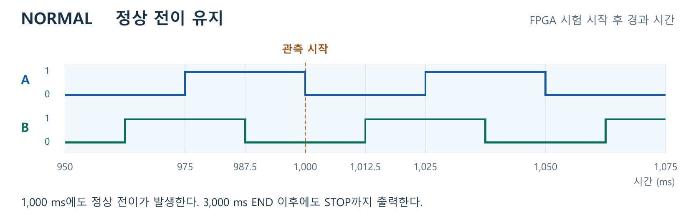
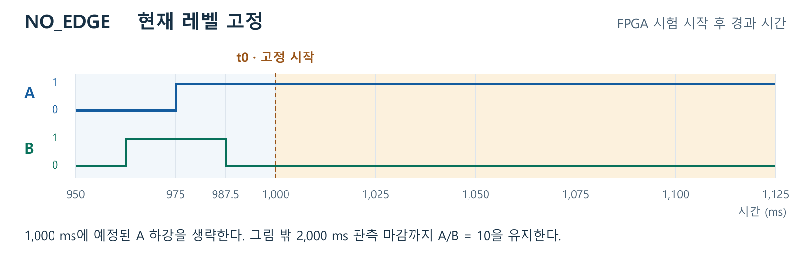
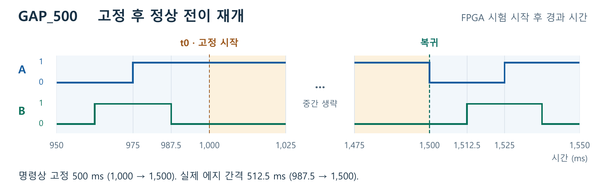

# CAN DO FPGA 구현 스펙

문서 버전 v1.1 · 작성일 2026년 11월 18일 · FPGA 담당 현수근

Basys3에서 엔코더 A/B 시험 신호를 생성하고, 모터 STM32의 진단 응답을 같은 FPGA 시계로 측정한다. Jetson에 시험 이벤트와 계측값을 전달하여 CAN 고장 보고와 같은 시험 회차로 연결한다. 이 문서는 RTL 구현, STM32·Jetson 인터페이스 협의, 통합 수락 시험의 기준으로 사용한다.

## 1 적용 기준과 담당 범위

**설계 기준**은 원문에 정의된 동작과 전송 형식이다. **초기값**은 실측 후 조정할 수 있는 파라미터다. **구현 제안**은 이 문서에서 구체화한 내부 처리 방식이며 관련 담당자와 검토한 뒤 구현 기준에 반영한다. **현물 확인**은 핀·배선·전기 조건을 실제 보드에서 대조할 항목이다.

| 항목 | 적용 기준 |
|---|---|
| 시험 플랫폼 | Digilent Basys3, 100 MHz 시스템 클록 기준 |
| 주 출력 | 3.3V 엔코더 A/B 2채널, 74HC157을 거쳐 모터 STM32 TIM4에 입력 |
| 관측 입력 | TEST_READY, DIAG_FAULT 각 1비트 |
| 계측 및 전송 | 1 MHz 타임스탬프, 내장 USB-UART, 115200 baud·8N1 |
| 기본 시나리오 | 1 NORMAL, 2 NO_EDGE, 3 GAP_500 |
| 판정 주체 | Jetson이 FPGA 기록과 CAN 고장·상태를 대조하여 판정 |
| FPGA 완료 조건 | 실제 A/B 출력과 이벤트 시각 일치, 진단 응답 캡처, UART 규격 일치, 반복 실행·중단 처리 검증 |

FPGA는 피드백 진단 시험에 필요한 입력과 시간 근거를 제공한다. 모터 STM32는 고장 검출과 GPIO·CAN 보고를 수행하고, 조작 STM32는 ARM_TEST·STOP·RESET과 운전 허가를 담당한다. Jetson은 기록·증거 연결·최종 판정을 수행한다.

### 근거 문서

| 식별자 | 문서와 적용 위치 |
|---|---|
| S1 | CAN_DO_시스템_설계서_v1.3.pdf, 2026-11-17, 36쪽. B.3의 신호 경로, B.7의 관측 GPIO, C8~C11의 시험·통신·판정·검증 기준 |
| S2 | CAN_DO_프로젝트_및_시험계획_요약_v1.3.pdf, 2026-11-17, 10쪽. 4쪽 구성, 5쪽 준비 시간 조건, 7~8쪽 판정·회차 연결, 9쪽 일정 |
| S3 | 2026-11-18 채팅으로 전달된 검토 내용. 12/08 사전 연동, 12/09 오전 수정·재시험 완료, 오후 합동 회귀·수락 순서 |
| S4 | Digilent Basys3 Master XDC. 클록, JA/JB, USB-UART 및 보드 버튼 후보 핀 |

<!-- pagebreak -->

## 2 외부 인터페이스와 배선

| 논리 신호 | 방향 | Basys3 연결 | 상대 연결 | 기준 |
|---|---|---|---|---|
| enc_a | 출력 | JA1 / J1 | 1 kΩ → MUX 3번, MUX 4번 → PB6 | LVCMOS33 |
| enc_b | 출력 | JA2 / L2 | 1 kΩ → MUX 6번, MUX 7번 → PB7 | LVCMOS33 |
| test_ready | 입력 | JB1 / A14 후보 | 모터 PC0 / CN7-38 후보 | 핀·헤더 도통 확인 |
| diag_fault | 입력 | JB2 / A16 후보 | 모터 PC1 / CN7-36 후보 | 핀·헤더 도통 확인 |
| uart_tx | 출력 | A18, 내장 USB-UART 송신 핀 | 보드 USB → Jetson USB | 실물 리비전 대조 |
| clk_100m | 입력 | W5 | 보드 클록 | 주기 10 ns |
| signal_gnd | 기준 | JA5 등 Pmod GND | 모터 보드 공통 GND | 신호 기준 전위 |

출처는 S1 B.3·B.7과 S4다. PC0/PC1의 실제 헤더 연결과 기존 I²C·GPIO 점유를 CubeMX, 보드 리비전, 도통 측정으로 확인한다. 후보 핀의 검증 결과를 XDC와 MCU 핀 표에 함께 반영한다.

MUX는 3.3V로 구동하며 선택 LOW는 REAL, HIGH는 TEST다. /G는 LOW다. 실제 엔코더 A/B는 레벨 변환 후 MUX 2·5번으로 들어가고, FPGA는 3·6번으로 들어간다. 시험 입력에는 원문 기준의 10 kΩ 풀다운을 적용한다. Pmod 전원핀과 다른 보드의 전원 연결은 원문 전원 배선 기준을 따른다.

### 신호 의미

- TEST_READY는 모터 MCU의 TEST_ARMED 또는 TEST_ACTIVE에서 HIGH다. 다른 상태에서는 LOW다.
- DIAG_FAULT는 fault_mask가 0이 아니면 HIGH이며, 명시 RESET으로 고장이 해제되면 LOW다. 원인 구분은 Jetson이 CAN 고장 비트로 확인한다.
- USB-UART는 FPGA에서 Jetson으로 시험 정보를 전송한다. 조작 명령은 기존 조작 MCU 경로를 사용한다.
- TEST 모드의 모터 공급 OFF·PWM LOW 확인은 MCU와 지그의 준비 조건이다. FPGA는 TEST_READY로 준비 허가를 받는다.

### 보드 로컬 조작 구현 제안

시나리오는 SW[1:0]의 01·10·11을 각각 NORMAL·NO_EDGE·GAP_500에 배정하고 00에서는 대기한다. 시작은 btnC, FPGA 로컬 리셋은 btnD를 후보로 둔다. btnC·btnD의 S4 후보 핀은 U18·U17이다. 버튼은 동기화·20 ms 안정 확인·새 눌림 검출을 거친다. 버튼 배정과 디바운스 시간은 구현 제안이다.

MCU의 고장 RESET과 FPGA 로컬 리셋은 별도 동작이다. 실행 중 FPGA 로컬 리셋은 세션 초기화로 처리하고 Jetson은 진행 회차를 판정 불가로 닫는다.

<!-- pagebreak -->

## 3 정상 A와 B 파형

**초기값은 각 채널 20 cycle/s, 위상차 90°이며, 균등한 4상 전이로 생성한다.** 각 상태를 12.5 ms 유지하면 A와 B 각각의 주기는 50 ms, 듀티는 50%가 된다. 기준 순서는 아래와 같고 MCU의 정방향 계수 부호와 대조한다.

| 정상 재생 경과 | A | B | 전이 |
|---|---|---|---|
| 0 ms | 0 | 0 | 시작 상태 |
| 12.5 ms | 0 | 1 | B 상승 |
| 25 ms | 1 | 1 | A 상승 |
| 37.5 ms | 1 | 0 | B 하강 |
| 50 ms | 0 | 0 | A 하강, 다음 주기 시작 |

상태 순서는 `{A,B} = 00 → 01 → 11 → 10 → 00`이다. 한 번에 한 비트만 바꾸고 A/B 출력은 레지스터에서 갱신한다. 100 MHz 클록에서는 1,250,000클록마다 상태를 한 단계 진행한다. 동작은 시스템 클록과 clock enable로 구성하는 방식을 제안한다.

| 구분 | 20 cycle/s일 때 |
|---|---|
| 채널 A 주기 / HIGH 유지 | 50 ms / 25 ms |
| 채널 B 주기 / HIGH 유지 | 50 ms / 25 ms |
| A/B 상태 전이 간격 | 12.5 ms |
| x4 계수 속도 | 80 count/s |
| 100 ms 기대 카운트 | 정방향 약 8 count |

### MCU가 확인할 baseline

FPGA는 정상 파형을 1초 출력한다. MCU는 ARM_TEST 수락 후 5초 안에 정상 전이의 500 ms 연속 확인을 완료해야 한다. 그 500 ms 동안 매 100 ms 구간의 정방향 카운트는 초기 기준 6~10 count이며 반대방향 전이 또는 연속 100 ms 무변화가 없어야 한다.

5초는 ARM_TEST 수락부터 세는 MCU의 준비 마감이다. FPGA 시작부터 세는 1초 baseline과 구분한다. ARM 수락 4.8초 뒤에 파형을 시작하면 연속 확인에 필요한 시간이 부족하다. 통합 조작은 READY 확인 후 지체 없이 시작하도록 한다.

RPM 표시는 출력축 1회전당 x4 유효 카운트 C를 실측한 뒤 환산한다. 80 count/s의 시험 입력은 4,800/C RPM에 대응한다. C 확정 전에는 cycle/s와 count/s를 시험 기준으로 사용한다.

<!-- pagebreak -->

## 4 시험 시나리오와 파형 경계

세 시험 모두 FPGA 시작 버튼이 수락된 시점부터 1초간 정상 A/B를 출력한다. 아래 그림의 시간은 그 시점부터 센 경과 시간이다. MCU는 이 구간에서 펄스를 계수해 TEST_ACTIVE로 전환한다. FPGA는 1,000 ms에 INJECT를 기록하고 시나리오별 관측을 시작한다.

| 시나리오 | FPGA A/B 동작 | END 시각 | MCU에서 확인할 결과 |
|---|---|---|---|
| 1 NORMAL | 정상 출력 계속 | 3,000 ms | TEST_ACTIVE 유지, CAN fault_mask=0, DIAG=0 |
| 2 NO_EDGE | 1,000 ms부터 현재 레벨 고정 | 2,000 ms | FEEDBACK_MISSING, FAULT, DIAG 상승 |
| 3 GAP_500 | 1,000 ms부터 고정, 1,500 ms에 정상 전이 재개 | 2,000 ms | 누락 고장 보고, 복귀 후에도 RESET 전까지 고장 유지 |

### 4.1 NORMAL 정상 파형 유지



FPGA는 A/B를 00에서 시작해 12.5 ms마다 한 비트씩 바꾼다. 그림에서 987.5 ms에는 B가 내려가며 11에서 10으로 바뀌고, 1,000 ms에는 A가 내려가며 10에서 00으로 바뀐다. NORMAL의 INJECT는 이 시점부터 관측을 시작했다는 표시다. 파형은 같은 간격으로 계속 진행한다.

1,000~3,000 ms의 2초 동안 MCU는 TEST_ACTIVE를 유지하고 DIAG와 CAN 고장 비트는 0이어야 한다. 3,000 ms에 END를 보내고도 펄스를 유지한다. STOP으로 READY가 내려가면 idle로 복귀한다.

<!-- pagebreak -->

### 4.2 NO_EDGE 현재 레벨 고정

1,000 ms에 파형 진행을 멈추고 A/B의 현재 값을 유지한다. MCU에는 마지막 정상 전이 이후 새 에지가 들어오지 않는다. 그림은 주입 경계를 확대해 보여준다. 고정 상태는 관측 마감인 2,000 ms까지 이어진다.



| FPGA 경과 시간 | A/B | 처리 |
|---|---|---|
| 987.5 ms | 11 → 10 | baseline의 마지막 정상 전이. B 하강 |
| 1,000 ms | 10 유지 | 예정된 A 하강을 생략. 고정 시작 시각 t0를 INJECT에 기록 |
| 1,000~2,000 ms | 10 유지 | MCU의 DIAG 상승을 관측. 첫 상승 시각 t1과 t1-t0를 DIAG_EDGE에 기록 |
| 2,000 ms | 관측 완료 | END 전송. 이후 출력 처리는 13절 참조 |

**10이 유지되는 이유**는 이 예에서 t0 직전 A가 HIGH, B가 LOW이기 때문이다. 고장 주입 시 레지스터 값을 유지하므로 t0에 새 에지가 생기지 않는다. 현재 값이 11인 조건에서는 A와 B가 모두 HIGH로 유지된다.

**MCU와 FPGA는 서로 다른 시점에서 시간을 센다.** MCU의 초기 누락 기준은 마지막 count 변화 후 200 ms다. 그림의 마지막 에지인 987.5 ms를 기준으로 하면 산술상 1,187.5 ms에 기준에 도달한다. 실제 DIAG 상승은 MCU의 진단 주기와 출력 지연을 포함한다. FPGA는 t0인 1,000 ms부터 DIAG 상승을 측정하며, Jetson은 초기 허용값 300 ms 이내인지 CAN의 FEEDBACK_MISSING 및 FAULT와 함께 확인한다.

<!-- pagebreak -->

### 4.3 GAP_500 고정 후 정상 복귀

NO_EDGE와 같은 방식으로 A/B를 고정하고, 500 ms 뒤에 멈췄던 상태의 다음 상태로 진행한다. 그림은 주입과 복귀 경계만 확대했다. 가운데 생략 구간에서도 A는 HIGH, B는 LOW를 유지한다.



| FPGA 경과 시간 | A/B | 처리 |
|---|---|---|
| 987.5 ms | 11 → 10 | 마지막 정상 전이 |
| 1,000 ms | 10 유지 | 고정 시작 t0 기록 |
| 1,500 ms | 10 → 00 | A 하강으로 정상 순서 재개 |
| 1,512.5 ms | 00 → 01 | B 상승. 이후 12.5 ms마다 계속 진행 |
| 2,000 ms | 관측 완료 | END 전송. 이후 출력 처리는 13절 참조 |

**500 ms는 고정 명령 구간**인 1,000~1,500 ms다. **MCU 입력의 에지 간격은 512.5 ms**로, 987.5 ms의 마지막 에지부터 1,500 ms의 복귀 에지까지다. 이 수치는 정상 전이와 고정 명령이 같은 클록에 예정될 때 고정을 우선하는 v1.0 구현 제안에 따른다. 이 제안의 t0·복귀 규칙은 FPGA와 MCU 담당자가 같은 기준으로 확인한다.

펄스가 복귀해도 MCU는 RESET 전까지 고장 래치를 유지해야 한다. DIAG 상승과 함께 READY가 내려가도 FPGA는 예정된 복귀 전이를 출력하고 2,000 ms에 END를 전송한다. 처음 연동할 때는 로직 분석기로 MCU의 PB6/PB7과 DIAG를 캡처하고, 에지 간격과 UART의 INJECT·DIAG_EDGE·END 기록을 비교한다.

<!-- pagebreak -->

## 5 시험 제어 상태와 중단 처리

FPGA 내부 상태는 구현 제안이다. UART phase는 원문의 0 idle, 1 baseline, 2 observe, 3 completed를 유지한다.

| 내부 상태 | 진입과 처리 | 출력 / UART phase |
|---|---|---|
| IDLE | 초기화 후 대기, READY·DIAG·새 시작 확인 | A/B 초기값 00 제안 / 0 |
| BASELINE | 시나리오 고정, run_seq 증가, BASELINE_START 기록 | 정상 A/B 1초 / 1 |
| OBSERVE | t0 캡처, INJECT, 시나리오 실행·DIAG 관측 | 시나리오 파형 / 2 |
| COMPLETED | 관측 마감에 END, 정상 시나리오 출력 유지 | 완료 후 정책 / 3 |
| ABORTED_HOLD | 실행 중단에 ABORT, 재시작 조건 대기 | idle 전환 제안 / 3 제안 |
| INVALID_HOLD | overflow 또는 로컬 무효 상태 래치 | 새 실행 억제, STATUS b3 |

시작 시 READY=1, DIAG=0, 유효한 시나리오, 새 버튼 눌림, 기존 실행 없음, overflow 없음을 확인한다. baseline/observe 중 시작 버튼은 현재 실행을 바꾸지 않는다. 시나리오 선택은 BASELINE_START에서 고정하며 실행 중 스위치 변경은 다음 회차에 적용한다.

### READY 하강과 DIAG 상승의 우선순위

1. 동기화된 DIAG 상승 시각을 먼저 캡처한다. 주입 후 첫 상승이면 t1과 latency를 저장한다.
2. READY 하강 시 DIAG가 아직 보이지 않으면 2 ms 유예하여 두 입력의 관측 순서 차이를 흡수한다.
3. 고장 시나리오에서 주입 후 DIAG 상승이 확인되면 시나리오·관측·END까지 진행한다. 고장 원인은 Jetson이 CAN으로 대조한다.
4. 유예가 끝나도 DIAG가 없으면 ABORT를 전송한다. Jetson은 STOP·EStop·모드 변경 근거가 있으면 ABORTED, 재부팅·단절·원인 불명이면 INCONCLUSIVE로 처리한다.

2 ms 유예는 300 ms 응답 기준을 늘리는 시간이 아니다. DIAG의 실제 관측 시각을 그대로 보존한다. 유예 중 출력 처리 방식과 baseline·NORMAL에서 예상 밖 DIAG 처리 방식은 13절의 구현 제안을 따른다.

### 다음 실행 수락

END 후 READY=0을 관측한 뒤 재상승하고, 버튼 해제 후 새 눌림이 있어야 다음 실행을 수락한다. 고장으로 이미 READY가 내려갔던 경우도 관측 완료와 다음 ARM을 구분한다. FPGA 리셋·overflow 해제 후에도 현재 READY가 HIGH라는 이유만으로 시작하지 않도록 새 준비 절차를 확인한다.

시험 도중 MCU RESET이나 STOP이 고장과 겹치면 FPGA의 두 GPIO만으로 원인을 모두 식별하기 어렵다. Jetson은 CAN 상태·명령 근거를 함께 사용하여 회차를 종료한다.

<!-- pagebreak -->

## 6 시간 계측과 입력 동기화

| 항목 | 요구 또는 초기값 |
|---|---|
| fpga_tick_us | 부팅 후 1 MHz u32 자유 실행 카운터 |
| baseline 시작 | 실제 정상 파형 실행 시작과 같은 제어 시점에 기록 |
| t0 | 실제 고정 동작이 시작되는 FPGA 제어 시점 |
| t1 | 동기화된 DIAG_FAULT의 주입 후 첫 상승 |
| latency_us | u32 모듈러 차분 t1-t0 |
| 누락 검출 초기값 | MCU의 마지막 count 변화 후 200,000 µs |
| GPIO 응답 허용 초기값 | t0부터 t1까지 300,000 µs 이내 |
| GPIO 순서 유예 | READY 하강 후 최대 2,000 µs |
| 실행 길이 | 60초 미만 |

1 MHz 카운터는 약 71분 35초마다 wrap된다. 단일 시험의 시간 차분은 u32 모듈러 연산으로 계산한다. 카운터 wrap을 FPGA 재부팅으로 오인하지 않도록 Jetson과 검증한다. 비정상 초기화·순번 역행이나 재부팅 여부가 모호한 경우 새 세션으로 처리한다.

타임스탬프는 이벤트가 발생한 순간 레지스터에 저장한다. FIFO 대기 시간과 UART 송신 시작 시각이 계측값을 바꾸지 않도록 한다. UART 도착 시각과 CAN 도착 시각의 차이는 통신 지연을 포함하므로 FPGA 지연과 별도로 기록한다.

### 입력 처리 구현 제안

TEST_READY·DIAG_FAULT는 각각 시스템 클록 도메인으로 2단 동기화한 후 사용하고, 동기화 레지스터에 ASYNC_REG 속성을 적용한다. 버튼과 스위치도 동기화하되 DIAG 관측에는 버튼용 20 ms 디바운스를 적용하지 않는다. MCU GPIO의 부팅·리셋 LOW와 입력 풀다운을 확인한다.

100 MHz 분주에서 100클록마다 1 µs clock enable을 생성한다. 1 µs는 타임스탬프의 단위다. 입력 동기화 지연, 클록 오차, MUX·배선 지연을 포함한 실제 계측 오차는 초기 지그 검증에서 측정한다.

### timing_valid

NO_EDGE/GAP_500에서 유효한 주입 이후 첫 DIAG 상승이 캡처되면 시간값을 유효하게 보고한다. baseline 중 고장, GPIO 검증 부족, overflow 등 계측 전제 불성립은 유효 시간 근거로 사용하지 않는다. GPIO의 실물 검증 상태는 Jetson 설정·manifest에도 기록한다.

정상 관측 완료까지 DIAG가 없으면 END의 timing_valid=0이다. NORMAL의 latency와 limit는 Jetson 결과에서 null이다. NO_EDGE/GAP_500은 관측·통신·GPIO가 모두 유효했다면 응답 없음 FAIL로 판정할 수 있다.

<!-- pagebreak -->

## 7 USB UART 프레임 규격

설계 기준은 FPGA wire protocol 1.0, 115200 baud, 8N1, 고정 22 byte, little-endian이다. 보드의 내장 USB-UART를 통해 Jetson USB로 연결한다.

| Byte | 필드 | 형식과 의미 |
|---|---|---|
| 0~1 | sync | A5 5A |
| 2 | major | u8, 1 |
| 3 | type | u8, 1 STATUS / 2 BASELINE_START / 3 INJECT / 4 DIAG_EDGE / 5 END / 6 ABORT |
| 4~5 | tx_seq | u16, 모든 전송 프레임마다 증가 |
| 6~7 | run_seq | u16, 수락된 시험마다 증가 |
| 8 | scenario | u8, 0 idle / 1 NORMAL / 2 NO_EDGE / 3 GAP_500 |
| 9 | phase | u8, 0 idle / 1 baseline / 2 observe / 3 completed |
| 10~13 | fpga_tick_us | u32, FPGA 부팅 후 1 MHz 카운터 |
| 14~17 | value | u32, DIAG_EDGE에서 주입 후 latency_us, 나머지는 0 |
| 18~19 | flags | u16, b0 READY / b1 DIAG / b2 timing_valid / b3 overflow 또는 invalid, b4~15는 0 |
| 20~21 | crc | CRC-16/CCITT-FALSE, B2~B19 대상, CRC 하위 바이트 먼저 |

CRC는 poly=0x1021, init=0xFFFF, refin=false, refout=false, xorout=0이다. 각 입력 바이트는 MSB부터 처리한다. 검사 문자열 `123456789`의 CRC 결과는 0x29B1이다.

### 골든 벡터

```text
A5 5A 01 03 03 00 01 00 02 02 40 42 0F 00 00 00 00 00 01 00 9E B0
```

이 벡터는 INJECT, tx_seq=3, run_seq=1, scenario=2, phase=2, tick=1,000,000 µs, value=0, READY=1, CRC=0xB09E를 뜻한다. 인코더와 Jetson 디코더 양쪽에서 길이·필드·CRC가 동일해야 한다.

STATUS는 100 ms마다, 이벤트는 발생 즉시 전송 대기열에 넣는다. 22 byte를 8N1로 보내는 선로 시간은 약 1.91 ms다. 이벤트 시각은 프레임 대기 전에 캡처하고, 같은 시각의 이벤트에는 일정한 전송 순서를 적용한다.

tx_seq는 u16 모듈러 순번으로 다루고 run_seq는 65535 이후 동일 연결에서 0을 재사용하지 않는다. run_seq 소진 시 보드 재설정과 새 fpga_session으로 다시 준비한다. 최초 tx_seq 값은 13절의 협의 항목이다.

<!-- pagebreak -->

## 8 UART 이벤트와 전송 무결성

| 이벤트 | 발생 시점 | 이벤트 데이터 |
|---|---|---|
| STATUS | 100 ms마다 | 현재 phase·scenario·READY·DIAG·계측/오류 상태 |
| BASELINE_START | 새 실행 수락·파형 시작 | 새 run_seq, 고정된 scenario, 시작 tick |
| INJECT | baseline 종료 | t0, observe 진입, value=0 |
| DIAG_EDGE | 주입 후 첫 DIAG 상승 | t1, latency_us, timing_valid |
| END | scenario 관측 구간 완료 | 완료 tick, 계측 유효성, 현재 관측 상태 |
| ABORT | 실행 중단 확정 | 중단 tick, 현재 관측 상태 |

STATUS는 대기 상태에서도 송신하여 Jetson이 새 실행 전 idle을 확인할 수 있게 한다. 이벤트는 실행 당시의 run_seq·scenario·phase·flags를 스냅샷으로 저장한다. 이미 큐에 넣은 이벤트가 나중 상태값으로 덮어써지지 않도록 한다.

### 큐와 overflow

pending 이벤트 FIFO 깊이는 16개다. FIFO가 가득 차면 overflow를 래치하고 STATUS b3으로 계속 보고한다. 로컬 리셋 전까지 다음 실행을 금지한다. 진행 중 회차의 증거가 손실되면 Jetson은 INCONCLUSIVE로 처리한다.

이벤트는 보존하고 STATUS의 미전송 중복 요청은 최신 상태로 합치는 방식을 구현 제안으로 둔다. tx_seq는 실제 프레임 송신 순서에서 부여한다. UART가 한 프레임을 보내는 동안에는 프레임을 완결하고 다음 프레임을 시작한다.

CRC 오류·순번 누락이 발생하면 Jetson은 sync를 다시 찾아 재동기화하고 진행 회차를 무효화한다. 이후 STATUS가 정상이어도 이미 빠진 시험 이벤트의 근거를 복원한 것으로 취급하지 않는다. 수신 STATUS 500 ms 공백도 진행 시험의 관측 단절로 처리한다.

### 세션

Jetson은 USB 연결마다 fpga_session UUID를 만들고 `(fpga_session, run_seq)`를 run_id로 사용한다. FPGA는 run_seq와 tx_seq 및 tick을 보낸다. UART의 phase에 새 내부 상태 번호를 임의 추가하지 않는다.

중간에 연결한 STATUS observe/completed만으로 시험 전체를 수락하지 않는다. 새 idle과 BASELINE_START부터 수집해야 한다. FPGA 리셋·연결 단절 뒤에는 새 준비와 새 시험 회차로 진행한다. 실행 중 MCU RESET의 세부 판정에는 CAN 명령·상태 근거를 사용한다.

<!-- pagebreak -->

## 9 Jetson 판정과 동일 회차 증거 연결

| 결과 | 적용 조건 |
|---|---|
| NORMAL PASS | 유효한 baseline과 전체 2초 관측, TEST_ACTIVE 유지, CAN fault_mask=0, DIAG=0, 기록 성공 |
| NO_EDGE PASS | 유효한 주입·1초 관측, 새 FEEDBACK_MISSING·FAULT·DIAG 상승, latency≤300,000 µs, 기록 성공 |
| GAP_500 PASS | NO_EDGE와 같은 근거, 500 ms 후 펄스 복귀 확인, RESET 전까지 고장 래치 유지 |
| FAIL | 시험·계측·통신이 유효한데 응답 없음, 틀린 고장, 정상 파형 오탐 또는 허용 시간 초과 |
| ABORTED | CAN 근거로 사용자 STOP·EStop·모드 변경·시험 중 RESET 확인 |
| INCONCLUSIVE | 시작·baseline·GPIO·세션·통신·로그 근거 부족, 원인 불명 또는 중간 접속 |

DIAG_FAULT는 모든 고장의 합성 신호다. 같은 회차에서 기대 고장 bit2 FEEDBACK_MISSING, 즉 0x0004와 FAULT 상태를 확인한다. 다른 새 고장 비트가 함께 발생하면 그 원인을 대조한다.

### 고장으로 epoch가 바뀌는 경우

첫 고장 래치로 모터의 제어 epoch가 바뀌어도 동일 motor_boot와 TEST 모드가 확인되면 진행 중 run_id를 유지한다. Jetson은 새 MOTOR_HELLO에서 epoch·boot를 확인하고 새 epoch의 MOTOR_STATE에서 TEST·FAULT, MOTOR_FAULT에서 새 FEEDBACK_MISSING을 대조한다. 여기에 같은 FPGA run의 INJECT·DIAG_EDGE·END를 연결한다.

관련 CAN ID는 MOTOR_HELLO 0x700, MOTOR_STATE 0x200, MOTOR_FAULT 0x090이다. STATE는 300 ms, FAULT는 1000 ms의 필드별 최신성 기준을 사용한다. 각 메시지의 freshness와 세션 확인을 통과한 근거를 사용한다.

### 마감과 저장

END 수신 후 최대 500 ms 동안 지연 CAN/UART 증거를 추가 수집한다. 이 기간은 test.status=RUNNING, reason=RESULT_PENDING으로 표시한다. 500 ms 수집 대기가 GPIO 응답 허용 300 ms를 바꾸지는 않는다.

최소 기록은 run_id, scenario_id, scenario_version, motor_boot, mode, 기대·관측 fault_mask, timing_source, latency_us, limit_us, result, reason, evidence_ids, 시작·종료 수신 시각이다. scenario_version은 fpga-basic/1.0을 적용한다.

원본 raw_fpga.jsonl·raw_can.jsonl과 events.jsonl을 연결하고 manifest.json에 FPGA build, XDC·설정 버전, GPIO 검증 여부를 남긴다. 저장 완료를 확인한 결과를 확정한다. 기능 관측 단계의 functional_only=true 설정은 GPIO 없는 시간 판정을 구분하는 데 사용한다.

<!-- pagebreak -->

## 10 RTL 구성과 파라미터

아래 모듈 경계는 구현 제안이다. 단일 100 MHz 클록에서 clock enable로 주기와 파형을 제어하고, UART 송신 상태가 파형·계측 진행을 지연시키지 않게 구성한다.

| 기능 | 처리 내용 | 주요 검증 |
|---|---|---|
| 입력·리셋 처리 | READY/DIAG 동기화, 버튼 디바운스, 새 눌림 | 부팅·버튼 유지·비동기 입력 |
| 시간 기준 | 1 µs tick, 12.5 ms 전이 허가 | 주기, wrap, 경계 클록 |
| A/B 생성 | 4상 상태, 유지, 복귀 | 한 비트 전이, 정방향, 불필요 에지 |
| 시나리오 제어 | baseline·observe·완료·중단, 재수락 | READY/DIAG 경합, 중복 시작 |
| 응답 캡처 | t0·첫 t1·latency·valid 저장 | 송신 대기와 무관한 시각 |
| 프레임·FIFO·CRC | 22 byte 구성, 순번, 이벤트 보존 | 골든 벡터, overflow |
| UART TX | 115200 8N1 직렬 송신 | 비트 시간, 프레임 연속성 |

| 파라미터 | 초기 설정 | 성격 |
|---|---|---|
| CLK_HZ / TICK_HZ | 100,000,000 / 1,000,000 | 보드 기준 / 원문 계측 단위 |
| AB_CYCLE_HZ / AB_STEP_US | 20 / 12,500 | 시험 초기값 / 파생값 |
| BASELINE_US | 1,000,000 | 원문 시나리오 |
| NORMAL_OBSERVE_US | 2,000,000 | 원문 시나리오 |
| FAULT_OBSERVE_US / GAP_US | 1,000,000 / 500,000 | 원문 시나리오 |
| READY_DIAG_GRACE_US | 2,000 | 원문 분류 유예 |
| STATUS_PERIOD_US | 100,000 | 원문 전송 주기 |
| EVENT_FIFO_DEPTH / UART_BAUD | 16 / 115200 | 원문 규격 |
| BUTTON_DEBOUNCE_US | 20,000 | 구현 제안 |

MCU의 200 ms 누락 검출, 500 ms 정상 확인, ARM 후 5초 마감은 MCU 설정이다. 300 ms PASS 한계와 END 후 500 ms 수집은 Jetson 판정 설정이다. 통합 manifest에서 각 설정의 소유자와 값을 함께 관리한다.

100 MHz를 정수 868클록/bit로 나누면 약 115207 baud가 되므로 이 분주를 구현 후보로 사용할 수 있다. 실제 baud 오차와 송신 파형을 측정한다. 1 µs tick을 단순 9분주하여 UART baud로 사용하면 오차가 커지므로 시스템 클록 기준으로 분주한다.

<!-- pagebreak -->

## 11 FPGA 수락 시험

표는 수행할 시험이다. 각 항목에 bitstream/build·설정·원본 증거·관측 결과를 연결하고, 단위 시뮬레이션과 현물 결과를 구분하여 기록한다.

| ID | 입력 또는 시험 | 완료 조건 |
|---|---|---|
| V01 | 부팅·로컬 리셋·시작 버튼 유지 | A/B 초기 상태, READY 없이 실행 없음, 새 눌림 수락 |
| V02 | NORMAL A/B | 20 cycle/s·90°·12.5 ms 전이, TIM4 100 ms당 정방향 약 8 count |
| V03 | 준비 마감 | ARM 후 5초 안에 MCU가 500 ms 연속 확인 완료, 늦은 시작은 준비 실패로 구분 |
| V04 | NO_EDGE | t0에 예정 에지 생략·현재 레벨 고정. INJECT 시각 일치 |
| V05 | GAP_500 | 고정 500 ms, 그림 4-3의 에지 간격 512.5 ms, 고장 래치 유지 |
| V06 | NORMAL 완료 | 2초 관측·END 후에도 정상 출력 유지, STOP 후 종료 |
| V07 | DIAG 상승·READY 하강 순서 교환 | 2 ms 내 순서 차이에서도 첫 t1 보존, 기대 고장 시 END까지 진행 |
| V08 | READY 하강·DIAG 없음 | 유예 후 ABORT, CAN 근거에 따른 최종 원인 분류 |
| V09 | 응답 경계·없음 | 299,999·300,000·300,001 µs 캡처값 구분, 유효 관측의 무응답은 FAIL 가능 |
| V10 | baseline 고장·예상 밖 고장 | timing_valid와 CAN 원인 대조, 근거에 맞는 FAIL/INCONCLUSIVE |
| V11 | 연속 시작·스위치 변경 | 회차·시나리오 불변, READY 재상승과 새 버튼 전 재시작 없음 |
| V12 | UART·CRC | 22 byte 골든 벡터, 0x29B1 검사, 시각·순번·LE 배치 일치 |
| V13 | FIFO16 overflow·UART 단절 | b3 래치·다음 실행 억제, Jetson INCONCLUSIVE |
| V14 | tick/tx_seq wrap·run_seq 소진 | 모듈러 차분 정확, run_seq 0 재사용 방지 |
| V15 | FPGA 재부팅·중간 접속 | 새 세션, 이전 run 무효화, 새 idle·BASELINE부터 재수락 |
| V16 | 고장 시 epoch 갱신 | 동일 boot·TEST 확인 후 같은 run_id에 새 epoch CAN 증거 연결 |
| V17 | 지그 현물 검증 | MCU 입력 PB6/PB7과 DIAG 동시 캡처, UART t0/t1와 실제 파형 대조 |
| V18 | GPIO 미연결·한쪽 전원 OFF | 입력 부유·역급전 조건 점검, 검증 전제 부족 시험의 판정 불가 처리 |

V17은 FPGA 출력 핀뿐 아니라 MUX를 지난 MCU 입력에서도 확인한다. 채널 A/B의 주기·순서, 고정 시작, GAP 복귀, DIAG 상승, 시험 이벤트를 한 회차 증거로 저장한다. 반응 지연은 원본 파형에서 계산한 값과 UART latency_us를 비교한다.

테스트벤치의 긴 시간 파라미터를 축소한 검증과 실제 초기값 검증을 구분한다. 최종 현물 수락은 실제 주기·시간 설정으로 수행한다.

<!-- pagebreak -->

## 12 통합 일정과 인계 항목

| 시점 | FPGA 관련 산출과 연동 | 확인할 근거 |
|---|---|---|
| 11/18~11/30 | 핀·전기 조건 확인, A/B 생성, 로컬 시나리오, UART 기본 구현 | XDC·파형·프레임 단위 결과 |
| 12/01 | 모터 전원 OFF 초기 CAN 연동에 시험 입력 지원 | 준비·STOP·허가 만료와 출력 상태 |
| 12/02~12/07 | GPIO 캡처·UART·중단·회차 연결의 선행 시험 완료 | V01~V18 중 통합 수락에 필요한 선행 결과 |
| 12/08 | 4장치 사전 연동, 수정 항목 도출 | run_id별 CAN·GPIO·UART·로그 대조 |
| 12/09 오전 | 수정·재시험 완료 | 변경 build·회귀 결과 확정 |
| 12/09 오후 | 합동 회귀·수락 시험과 시연 자료 확정 | 확정 build·설정·시험 결과 패키지 |

기간은 S2의 일정과 S3의 당일 순서를 적용한다. FPGA 세부 작업은 해당 구간의 구현 계획이며 간트 작업 ID별 공수와 구분한다. 12/09 FP-10 수정·재시험 완료를 오후 JQ-12 합동 시험의 선행 조건으로 반영한다. CM-13·OM-10도 같은 완료 순서를 따른다.

### 인계할 파일과 기록

- 합성 가능한 RTL, top module 및 XDC, 사용한 Vivado 버전과 build 식별자
- bitstream, 실제 적용 파라미터, GPIO·MUX 배선 확인 결과
- 세 시나리오의 시뮬레이션·현물 파형과 UART 원본, CRC fixture
- NORMAL·NO_EDGE·GAP_500의 run_id별 결과와 중단·재부팅·overflow 시험 기록
- 알려진 미완료 항목과 재현 절차, MCU·Jetson과 합의한 인터페이스 표

### 참고 자료 경로

[S1 시스템 설계서](CAN_DO_시스템_설계서_v1.3.pdf)

[S2 프로젝트 및 시험계획 요약](CAN_DO_프로젝트_및_시험계획_요약_v1.3.pdf)

[S4 Digilent Basys3 Master XDC](https://raw.githubusercontent.com/Digilent/digilent-xdc/master/Basys-3-Master.xdc)

<!-- pagebreak -->

## 13 현물 확인과 구현 제안 협의

설계 기준에 정의된 동작을 구현하면서 아래 세부 사항을 담당자 간에 확인한다. 후보 핀과 계측 초기값은 현물 검증으로 확정하고, 내부 처리 제안은 테스트벤치·Jetson 디코더와 같은 기준으로 맞춘다.

| 항목 | 확인 주체와 결정할 내용 |
|---|---|
| GPIO 핀 확정 | FPGA·모터 담당. PC0/PC1 헤더·I²C 점유·부분 전원 조건·풀다운 확인 |
| 전이 방향·RPM | FPGA·모터 담당. 00→01→11→10의 MCU 부호, 출력축 C 실측과 RPM 표시 |
| 주입·복귀 경계 | FPGA·모터·Jetson 담당. 4절의 고정 우선·500 ms 시점 전이 제안 및 t0 정의 확인 |
| READY 유예 중 출력 | FPGA 담당 제안. 2 ms 동안 현재 레벨을 유지하고, DIAG 확인 후 기존 시나리오를 이어감. 무관 고장은 Jetson이 대조 |
| baseline·NORMAL 조기 고장 | FPGA·Jetson 담당 제안. 조기 DIAG 이벤트는 value=0·timing_valid=0으로 보고하고, 유효 baseline 오탐과 전제 부족을 구분 |
| 완료·중단 출력 | FPGA·Jetson 담당 제안. END 후 READY가 HIGH면 시나리오 출력 유지, LOW면 idle=00. ABORT도 idle=00·phase=3으로 보고 |
| flags b2 유지 | FPGA·Jetson 담당 제안. 새 run에서 초기화하고 첫 유효 t1 뒤 END까지 유지. NORMAL은 0. b3 래치가 있으면 전체 계측 무효 |
| 같은 클록의 경계 | FPGA·Jetson 담당 제안. 고정과 t0를 원자적으로 기록하고 DIAG가 같은 클록이면 그 시각으로 캡처. 관측 마감과 t1이 같으면 DIAG_EDGE 후 END 송신 |
| 순번 초기값 | FPGA·Jetson 담당 제안. tx_seq는 리셋 후 첫 프레임 0, run_seq는 idle 0·첫 수락 1. wrap 및 소진 규칙 공동 확인 |
| 로컬 버튼·기능 관측 | FPGA 담당. 2절 후보 배정과 디바운스 확인. GPIO 없는 개발 단계는 functional_only로 기록 |

위 구현 제안은 프레임의 바이트 배치를 유지하면서 미정 동작을 구체화한다. 담당자 합의 결과를 설정·시나리오 버전에 기록한다. 초기값 변경 시 FPGA·MCU·Jetson·시험 fixture의 일치를 확인한다.
