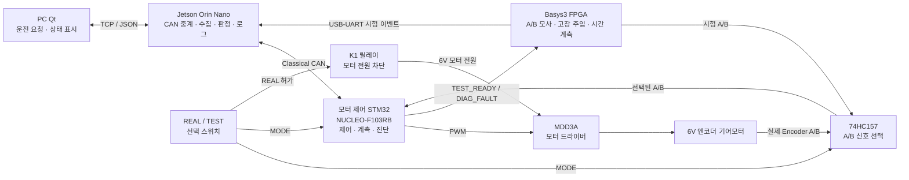
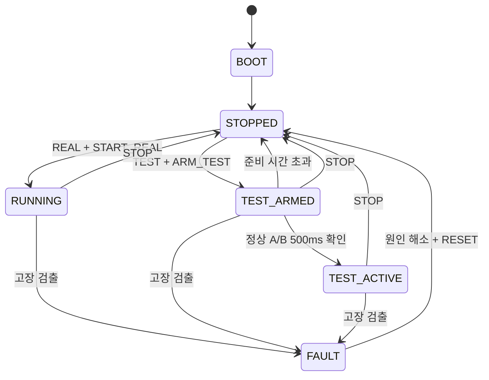

# CAN DO — 시스템 설계

> CAN 기반 모터 제어·진단 검증 시스템의 GitHub 공개용 설계 문서입니다.  
> **설계 기준:** 시스템 설계서 v1.5 · 2026-11-19

## 프로젝트 개요

CAN DO는 전동 시트의 전후 이동을 단순화한 **6V 엔코더 기어모터 제어·진단 시험 시스템**입니다.

실제 운전에서는 STM32가 모터를 제어하면서 엔코더, 전류, 전압을 측정합니다. TEST 모드에서는 실제 모터 전원을 차단하고 FPGA가 엔코더 A/B 신호를 재현하거나 고장 패턴을 주입합니다. STM32는 실제 운전과 동일한 피드백 진단 로직으로 이상을 검출하고, Jetson은 CAN 상태와 FPGA 계측 근거를 결합해 시험 결과를 판정합니다.

| 항목 | 내용 |
|---|---|
| 주요 검증 대상 | 모터 제어 STM32의 피드백 진단과 상태 보고 |
| 실제 운전 | PWM 제어, 엔코더 RPM, 전류·전압 측정 |
| 시험 입력 | FPGA 기반 엔코더 A/B 모사 및 고장 주입 |
| 결과 판정 | Jetson이 CAN·FPGA 근거를 비교해 판정 |
| 사용자 인터페이스 | PC Qt에서 운전 요청·상태·시험 결과 표시 |
| 초기 시연 범위 | 한 방향 기동·회전·정지 |
| 후속 범위 | 시트 레일, 위치 제어, 양방향 운전 |

> **현재 상태**  
> v1.5는 멘토링 이후 개정된 설계 기준입니다. Qt 제어 계약, 일부 GPIO, 실측 기반 FPGA 프로파일, 운전 한계값은 통합·현물 검증 전이며 실제 구현 완료를 의미하지 않습니다.

---

## 전체 시스템 구조



### 장치별 역할

| 장치 | 역할 | 주요 연결 |
|---|---|---|
| 모터 제어 STM32 | PWM 제어, 엔코더/RPM 계측, INA226 계측, 상태머신, 고장 진단, CAN 처리 | MDD3A, MUX, INA226, CAN, MODE |
| Jetson Orin Nano | Qt 요청 중계, CAN/UART 수집, 데이터 정리, 시험 판정, 로그·리플레이 | USB-CAN, FPGA USB-UART, TCP |
| Basys3 FPGA | 엔코더 A/B 생성, 고장 주입, 진단 응답 시간 계측 | MUX, TEST_READY, DIAG_FAULT, USB-UART |
| PC Qt | START/STOP/RESET/ARM_TEST 요청, 상태·측정·시험 결과 표시 | TCP |
| MDD3A | 6V 모터 H-Bridge 구동 | STM32 PWM, 모터 |
| U200 / INA226 | 모터 공급측 전류·전압 계측 | STM32 I²C |
| 74HC157 | 실제 엔코더와 FPGA 시험 A/B 선택 | MODE, Encoder A/B, FPGA A/B |
| K1 릴레이·E-STOP | TEST/E-STOP에서 실제 모터 전원 차단 | 5V 코일 회로, 6V 모터 전원 |

---

## 핵심 설계 결정

### Qt → Jetson → CAN → 모터 STM32를 기본 제어 경로로 사용

기본 구성에서 운전 명령은 다음 경로로 전달합니다.

```text
PC Qt
  ↓ TCP
Jetson
  ↓ CAN
모터 제어 STM32
  ↓ PWM
MDD3A
  ↓
모터
```

- Jetson이 기본 구성에서 **유일한 운전 허가·명령 CAN 송신원**입니다.
- 두 번째 조작 STM32는 기본 구성에서 제외하고 **선택 확장**으로 둡니다.
- 물리 조작 MCU를 추가할 경우 두 제어 주체가 동시에 명령하지 않도록 별도의 제어권 설계가 필요합니다.
- FPGA 시험 파형 시작은 현재 Basys3의 로컬 버튼을 사용합니다.

### REAL과 TEST는 같은 STM32 입력과 같은 진단 로직을 사용

```text
REAL
실제 엔코더 A/B
      ↓ 5V
레벨 변환
      ↓ 3.3V
      ┐
      ├─ 74HC157 ─→ STM32 PB6/PB7 ─→ 공통 피드백 진단
      │
FPGA 시험 A/B
      ┘
TEST
```

`MODE`는 하나의 신호를 MUX와 모터 STM32가 함께 사용합니다.

- `LOW = REAL`
- `HIGH = TEST`

MUX는 **어떤 A/B 신호를 STM32에 연결할지** 결정합니다.  
STM32는 MODE를 **운전 환경, PWM 허용 여부, 진단 활성 조건**을 구분하는 데 사용합니다.

중요한 원칙은 **피드백 고장 진단의 정답을 MODE에서 얻지 않는 것**입니다.

```text
REAL RUNNING ─┐
              ├─ 동일한 피드백 감시 함수 ─→ FEEDBACK_MISSING 등
TEST_ACTIVE ──┘
```

즉 FPGA가 고장을 넣었다는 사실이 아니라, PB6/PB7에서 실제로 관측한 A/B 상태를 기준으로 진단합니다.

### 고장 검출과 시험 판정을 분리

```text
FPGA
  └─ 시험 조건을 재현하고 주입 시점을 기록

모터 STM32
  └─ 실제 입력을 기준으로 어떤 고장인지 진단

Jetson
  └─ 미리 정의된 기대 결과와 실제 진단 근거를 비교해 PASS/FAIL 판정
```

STM32가 `FAULT`를 보고했다고 해서 시험이 자동으로 FAIL인 것은 아닙니다.  
고장 주입 시험에서는 **기대한 고장을 정확한 조건과 시간 안에 검출하면 PASS**입니다.

---

## 안전 및 전원 구조

### 전원 구성

| 전원 | 용도 |
|---|---|
| 6V | 모터 구동부 |
| 5V | STM32 제어부, 엔코더, 릴레이 코일, 센서 HOST |
| 3.3V | STM32·FPGA 디지털 신호 |
| Jetson | 전용 전원 |
| Basys3 | USB 전원 |

`+5V`와 `+6V`는 분리합니다. GND는 시스템 신호 기준에 따라 연결하되, 모터 전력 귀환은 MCU나 브레드보드를 통과시키지 않고 굵은 배선으로 어댑터 음극 분배점에 직접 귀환시킵니다.

### TEST와 E-STOP은 소프트웨어와 독립적으로 모터 전원을 차단

```text
5V 제어 전원
    ↓
E-STOP NC1
    ↓
REAL/TEST의 REAL 접점
    ↓
청색 수동 재투입 + 릴레이 자기유지
    ↓
K1 코일
```

```text
6V 모터 전원
    ↓
퓨즈
    ↓
K1 주접점
    ↓
INA226
    ↓
MDD3A
    ↓
모터
```

- TEST 선택 또는 E-STOP 동작 시 K1 코일이 떨어져 **6V 모터 전원이 물리적으로 차단**됩니다.
- 제어부 5V는 유지되어 STM32 진단과 CAN 통신은 계속 동작합니다.
- 청색 재투입 버튼은 소프트웨어 명령이 아니라 **하드웨어 자기유지 회로 복구**입니다.
- 전원 복구, 통신 재연결, RESET, E-STOP 해제만으로 모터를 다시 돌리지 않습니다.
- 실제 운전을 다시 시작하려면 항상 새로운 START가 필요합니다.

> E-STOP NC2 상태를 모터 STM32가 직접 읽는 방향은 현재 설계 제안이며, 실제 핀과 전기 조건은 현물 검증 후 확정합니다.

---

## 운전 상태와 복구

### 주요 상태



### 상태 처리 원칙

- REAL/TEST는 **mode**, `STOPPED`, `RUNNING`, `TEST_ARMED`, `TEST_ACTIVE`, `FAULT`는 **state**입니다.
- MODE가 바뀌면 즉시 PWM을 LOW로 만들고 입력 안정화 후 카운터와 필터를 초기화합니다.
- STOP은 출력을 억제하지만 고장 래치를 지우지 않습니다.
- RESET은 현재 고장 원인과 해제 조건이 만족된 경우에만 허용합니다.
- REAL 복귀, E-STOP 해제, 통신 복구만으로 운전하지 않습니다.

### REAL 운전 흐름

```text
REAL 확인
  ↓
청색 재투입
  ↓
필요 시 RESET
  ↓
Qt START 요청
  ↓
Jetson CAN 명령
  ↓
STM32 조건 확인
  ↓
PWM 출력 · RPM/전류/전압 계측
```

### TEST 흐름

```text
TEST 선택
  ↓
6V 모터 전원 OFF + PWM LOW 확인
  ↓
필요 시 RESET
  ↓
Qt 시험 준비 요청
  ↓
ARM_TEST
  ↓
TEST_READY
  ↓
FPGA 로컬 시험 시작
  ↓
정상 A/B → 고장 주입
  ↓
STM32 진단
  ↓
FPGA 시간 계측 + CAN 상태
  ↓
Jetson 시험 판정
```

---

## 고장 진단

모터 STM32는 16비트 `fault_mask`를 사용하며, 현재 범위의 주요 고장은 다음과 같습니다.

| Bit | 코드 | 의미 |
|---:|---|---|
| 0 | `ESTOP` | 비상정지 또는 상태 입력 이상 |
| 1 | `OP_LINK_LOSS` | 운전 허가 통신 소실 |
| 2 | `FEEDBACK_MISSING` | 엔코더 피드백 누락 |
| 3 | `OVERSPEED` | 모터 과속 |
| 4 | `OVERCURRENT` | 모터 과전류 |
| 5 | `SENSOR_INVALID` | 센서 데이터 오류 |
| 6 | `MOTOR_SUPPLY` | 모터 공급 전원 이상 |
| 7 | `MODE_UNSTABLE` | REAL/TEST 입력 불안정 |
| 8 | `INTERNAL` | 내부 시스템 오류 |

- `fault_mask`는 고장이 발생하면 래치합니다.
- 원인이 사라져도 명시적인 RESET 전까지 기록을 유지합니다.
- 아직 구현하지 않은 진단 항목은 임의로 fault bit를 설정하지 않습니다.
- TEST에서 실제 모터 전류와 회전이 없는 것은 정상 시험 조건이므로, REAL과 TEST에서 진단 활성 조건을 구분합니다.

---

## 통신 구조

### Classical CAN

| 항목 | 기준 |
|---|---|
| 통신 방식 | Classical CAN |
| CAN ID | 11-bit 표준 ID |
| 속도 | 125 kbit/s |
| 데이터 길이 | 정의 메시지 DLC=8 |
| 바이트 순서 | Little-endian |
| 기본 구성 | 모터 STM32 ↔ Jetson USB-CAN |
| 종단 | 두 끝 120Ω |

기본 구성은 모터 STM32와 Jetson USB-CAN의 **2노드 버스**입니다.

### 주요 CAN 메시지

| CAN ID | 메시지 | 방향 | 역할 |
|---:|---|---|---|
| `0x080` | `OP_PERMIT` | Jetson → STM32 | 주기 운전 허가 |
| `0x100` | `COMMAND` | Jetson → STM32 | START/STOP/RESET/ARM_TEST |
| `0x110` | `COMMAND_RESULT` | STM32 → Jetson | 명령 처리 결과 |
| `0x090` | `MOTOR_FAULT` | STM32 → Jetson | 고장 비트와 이벤트 |
| `0x200` | `MOTOR_STATE` | STM32 → Jetson | 상태·모드 |
| `0x210~0x212` | 측정 프레임 | STM32 → Jetson | RPM/PWM·전류/전압·시간 |

v1.5에서는 기존 프레임 배치를 유지하면서 **명령·허가 송신원을 Jetson으로 변경하는 CAN 2.1 초안**을 사용합니다.

### 주기 허가

- Jetson → STM32: `OP_PERMIT` **50ms 주기**
- 모터 MCU의 초기 허가 만료 제안: **200ms**
- 허가가 끊기면 STM32는 PWM을 LOW로 만들고 현재 운전 세션을 종료합니다.
- 통신이 복구돼도 자동 재기동하지 않습니다.

### Qt ↔ Jetson

- 유선 TCP
- Jetson 서버 포트: `5000`
- UTF-8 JSON + LF 프레이밍
- Qt는 운전 요청과 heartbeat를 전송
- Jetson은 현재 연결·모드·세션을 확인한 뒤 CAN 명령을 전달
- 미확인 START/ARM_TEST/RESET은 자동 재전송하지 않음

### FPGA → Jetson

- Basys3 내장 USB-UART
- `115200 8N1`
- 시험 시작·주입·진단 관측·완료 이벤트 전송
- sequence와 CRC를 이용해 손실·오류 확인

> CAN/TCP/UART의 바이트 단위 상세 규격은 구현 단계에서 별도 프로토콜 문서로 분리하는 것이 적절합니다. 이 문서에서는 시스템 구조와 설계 의도만 유지합니다.

---

## FPGA 시험 설계

### 기본 시험 시나리오

| 시나리오 | 입력 | 기대 결과 |
|---|---|---|
| `NORMAL` | 정상 A/B 직교 펄스 | `TEST_ACTIVE`, 고장 없음, `DIAG_FAULT=0` |
| `NO_EDGE` | 정상 구간 후 A/B를 1초간 고정 | `FEEDBACK_MISSING`, `FAULT`, `DIAG_FAULT=1` |
| `GAP_500` | 정상 구간 후 500ms 고정 뒤 복귀 | 피드백 누락 고장 검출, 펄스 복귀 후에도 래치 유지 |

초기 시험값:

- 정상 baseline: **1초**
- TEST_ACTIVE 진입용 정상 A/B 확인: **500ms**
- ARM 수락 후 준비 완료 제한: **5초**
- 피드백 누락 검출 초기값: **200ms**
- FPGA 주입 → `DIAG_FAULT` 응답 허용 초기값: **300ms**

이 값들은 **교육용 초기 제안값**이며 실제 운전 한계나 motor-grade 요구사항이 아닙니다. 최종값은 실측 후 확정합니다.

### TEST_READY / DIAG_FAULT

| 신호 | 방향 | 목적 |
|---|---|---|
| `TEST_READY` | STM32 → FPGA | STM32가 시험 입력을 받을 준비가 되었음을 알림 |
| `DIAG_FAULT` | STM32 → FPGA | 고장 진단 발생 시점을 FPGA가 직접 관측 |

FPGA는 자신이 A/B 고장을 주입한 시점과 `DIAG_FAULT` 상승 시점을 같은 FPGA clock으로 측정하여 진단 응답 시간을 계산합니다.

GPIO 후보 핀은 CubeMX, Basys3 XDC, 부분 전원 상태와 실제 보드 헤더를 확인한 뒤 확정합니다.

---

## 실제 모터 기반 FPGA 모사

고정 주파수 펄스만 생성하면 실제 모터 거동과 차이가 크므로, 기본 시험이 안정화된 뒤 **REAL 운전 실측값을 이용한 FPGA 프로파일 재생**을 확장합니다.

### REAL 운전에서 확보할 데이터

동일 조건으로 6V REAL 운전을 최소 3회 반복하여 다음 값을 기록합니다.

- MCU 기준 시간
- 목표 RPM
- 실제 RPM
- PWM 명령값
- 회전 방향
- 유효한 공급 전압·전류
- 기동·정상 회전·정지 구간

오실로스코프 또는 로직 분석기로 **PWM과 실제 엔코더 A/B 파형이 로그와 일치하는지 먼저 확인**합니다.

```text
실제 모터 운전
    ↓
PWM · A/B · RPM 계측
    ↓
정상 응답 특성 추출
    ↓
FPGA A/B 프로파일 생성
    ↓
동일 조건의 반복 가능한 시험 입력
```

### 실측형 프로파일 재생

실측형 시험에서는 FPGA가 실제 엔코더의 위상 순서를 유지하면서 펄스 간격을 시간에 따라 변경합니다.

```text
고정 baseline
    ↓
실측 정상 구간 재생
    ↓
정해진 주입 시점
    ↓
A/B 고정 또는 누락
    ↓
STM32 진단 응답 확인
```

시험 재현성을 위해 다음 정보를 함께 기록합니다.

- `profile_id`
- 원본 REAL 운전 식별자
- 사용한 시간 구간
- 엔코더 환산 기준
- 고장 주입 위치
- 펌웨어 및 시험 조건

실측형 프로파일은 현재 **확장 설계**이며, 기본 `NORMAL / NO_EDGE / GAP_500` 시험을 먼저 안정화한 뒤 적용합니다.

---

## 시험 결과 판정

| 결과 | 판정 기준 |
|---|---|
| `PASS` | 필요한 시험 근거가 모두 유효하고 기대한 고장 코드·상태·GPIO·시간 조건을 만족 |
| `FAIL` | 시험 근거는 유효하지만 기대 응답이 없거나 코드가 틀리거나 시간 기준 초과 |
| `ABORTED` | 사용자가 STOP, E-STOP, MODE 변경 등으로 시험을 중단 |
| `INCONCLUSIVE` | 통신·GPIO·로그·baseline 등 필수 근거가 부족해 합격/불합격을 판단할 수 없음 |

Jetson은 STM32가 보고한 값을 보고 기대 결과를 역산하지 않습니다.  
시험 시나리오에 기대 결과를 미리 정의하고, 다음 근거를 같은 시험 회차로 연결하여 판정합니다.

- FPGA 시나리오와 주입 시각
- `DIAG_FAULT` 관측
- 모터 MCU 부팅/세션
- `MOTOR_FAULT`
- `MOTOR_STATE`
- CAN 데이터 최신성
- 시험 로그 저장 성공 여부

필수 근거를 동일 시험으로 연결할 수 없으면 `INCONCLUSIVE`로 처리합니다.

---

## 로그와 리플레이

Jetson은 CAN과 FPGA의 **원본 데이터와 해석 결과를 함께 저장**합니다.

REAL 운전에서는 운전 회차별로 다음 값을 연계합니다.

- MCU 시간과 세션
- 목표/실제 RPM
- PWM
- 전압·전류
- mode/state
- 원본 CAN 기록

TEST에서는 다음 근거를 연결합니다.

- 시험 시나리오
- FPGA 주입·응답 시간
- 기대/관측 fault
- CAN 상태
- 최종 판정과 사유

리플레이는 저장된 데이터를 동일한 정규화·판정 경로에 다시 넣는 기능입니다.  
**리플레이 중에는 실제 CAN/UART 제어 신호를 송신하지 않습니다.**

---

## 주요 하드웨어 인터페이스

### 모터 STM32

| 기능 | STM32F103 핀 | 연결 |
|---|---|---|
| CAN TX/RX | PA12 / PA11 | SN65HVD230 |
| Encoder TIM4 | PB6 / PB7 | 74HC157 출력 |
| INA226 I²C1 | PB8 / PB9 | U200 SCL/SDA |
| Motor PWM TIM3 | PA6 / PA7 | MDD3A M1A/M1B |
| MODE | PC2 | REAL/TEST 레벨 변환 신호 + MUX Select |

추가 시험 계측 후보:

- `TEST_READY`: PC0
- `DIAG_FAULT`: PC1

후보 GPIO는 실제 보드 헤더, CubeMX 핀 사용 상태, FPGA XDC를 확인한 뒤 확정합니다.

---

## 검증 순서

### 1. 무전원 점검

- 단락·극성 확인
- 릴레이 접점 확인
- flyback diode 방향 확인
- CAN H-L 약 60Ω 확인

### 2. 제어 전원

- E5V·3.3V 실측
- 부팅·리셋 중 M1A/M1B LOW 확인

### 3. 차단 회로

- 청색 재투입
- E-STOP
- TEST 전환
- 모터 6V 공급 소실
- 잔류 회전 확인

### 4. CAN·신호 경로

- 125 kbit/s 송수신
- 실제 엔코더 A/B
- FPGA A/B
- MODE 전환

### 5. 저부하 REAL 운전

- 낮은 Duty부터 시작
- 전압·전류·온도 확인
- 계획한 회전 방향 확인
- STOP 후 PWM 억제와 실제 축 정지 구분 측정

### 6. 고장·복구 시험

- CAN 단절
- 피드백 누락
- MCU 리셋
- E-STOP
- MODE 변경
- 재연결 후 자동 재시작 없음 확인

### 7. FPGA 계측 경로 검증

초기 시험 지그 검증 시 로직 분석기로 다음 신호를 함께 캡처합니다.

```text
STM32 입력 A/B
DIAG_FAULT
```

이를 통해 FPGA의 주입 시점과 실제 STM32 입력, 진단 GPIO 응답이 일치하는지 확인합니다.

---

## 현재 미확정 항목

다음 항목은 실측 또는 통합시험 후 확정합니다.

- E-STOP NC2의 모터 STM32 입력 핀과 전기 회로
- 실제 USB-CAN 종단 설정
- `TEST_READY`, `DIAG_FAULT` GPIO 최종 핀
- 출력축 1회전당 실제 엔코더 카운트
- `RPM_MAX`
- 실제 기동 유예 시간
- 과전류·과속 임계값
- REAL 공급 정상 / TEST 공급 OFF 판정 임계값
- 200ms / 300ms 진단 시간 기준의 최종값
- 실측 FPGA 프로파일의 허용 오차
- Qt/Jetson 단절·재접속 제어 계약의 현물 검증

확정되지 않은 값은 구현 또는 계측 완료 전까지 **제안값**으로 표시합니다.

---

## 구현 범위

### 기본 구성

- 모터 제어 STM32 / NUCLEO-F103RB 1대
- Basys3 FPGA
- Jetson Orin Nano
- PC Qt
- 절연 USB-CAN
- 6V 엔코더 기어모터
- MDD3A
- INA226 U200
- 74HC157
- 릴레이 기반 안전 차단 회로

### 선택 확장

두 번째 STM32를 추가하여 물리 START/STOP/RESET 입력을 구성할 수 있습니다.

다만 v1.5의 기본 제어권에는 포함하지 않으며, 실제로 추가할 경우 **명령 송신 주체와 제어권 충돌 처리**를 먼저 정의합니다.

---

## 설계 원칙

1. **안전 차단은 애플리케이션 소프트웨어에만 의존하지 않습니다.**
   - TEST와 E-STOP은 릴레이를 이용한 물리 전원 차단 경로를 가집니다.

2. **고장 진단과 시험 판정을 분리합니다.**
   - STM32는 어떤 고장이 발생했는지 판단합니다.
   - Jetson은 그 결과가 시험의 기대 동작과 일치하는지 판단합니다.

3. **REAL과 TEST의 피드백 진단 로직을 공유합니다.**
   - MODE는 운전 환경을 정의하며 고장 정답을 알려주는 신호가 아닙니다.

4. **통신 성공과 명령 실행 성공을 구분합니다.**
   - CAN 전송 성공만으로 모터 상태 변경을 확정하지 않습니다.

5. **0과 결측·오래된 값·잘못된 값을 구분합니다.**
   - 센서나 통신 이상을 정상적인 0 값으로 보정하지 않습니다.

6. **복구가 자동 운전을 의미하지 않습니다.**
   - 전원·통신·E-STOP·RESET이 복구되어도 새로운 START가 필요합니다.

7. **추정값보다 실측값을 우선합니다.**
   - RPM 환산, 운전 한계, 진단 시간, FPGA 실측형 프로파일은 실제 계측 결과를 기준으로 확정합니다.

---

## 문서 기준

이 문서는 **CAN DO 시스템 설계서 v1.5(2026-11-19)**를 GitHub에서 빠르게 읽을 수 있도록 재구성한 공개용 설계 요약입니다.

원본 설계서의 다음 세부사항은 이 문서에서 의도적으로 축약했습니다.

- 전체 BOM과 구매 가격
- 모든 CAN byte 배치와 예제 payload
- TCP JSON 전체 스키마
- FPGA UART 22-byte 세부 프레임
- 데이터 freshness·로그 파일 포맷의 세부 규칙
- v0.4 이전 규격과의 호환 참고사항
- 팀 내부 역할 분장과 문서 개정 이력

구현이 진행되면 실측 결과와 검증 증거는 설계 문서에 계속 덧붙이지 않고 별도의 `test_results/` 문서로 관리합니다.
