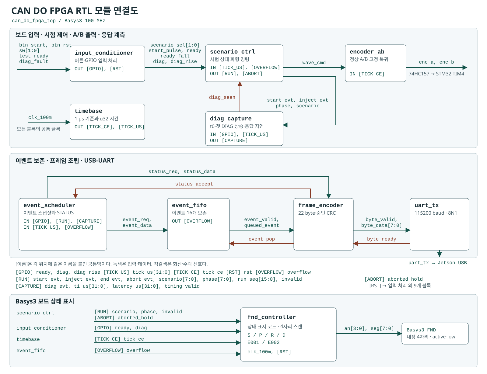

# CAN DO FPGA 모듈 구조

[FPGA 구현 스펙 v1.4](../docs/FPGA_구현_스펙_v1.4.md)의 기본 시나리오 3종, USB-UART 계측과 FND 표시을 기준으로 작성한 RTL 설계안이다. 모듈명과 포트명은 제안이며, 각 블록의 입력은 왼쪽, 출력은 오른쪽에 배치했다.

## Top 모듈 연결도



[연결도 원본 열기](FPGA_모듈_연결도.svg)

화살표가 시작하는 쪽이 보내는 모듈이고 끝나는 쪽이 받는 모듈이다. 떨어진 곳에 같은 이름의 대괄호 표기가 있으면 같은 내부 신호 묶음이다. 받는 블록은 해당 묶음에서 필요한 신호를 사용한다.

| 연결 | 보내는 모듈 → 받는 모듈 | 신호 |
| --- | --- | --- |
| 엔코더 출력 제어 | `scenario_ctrl` → `encoder_ab` | `wave_cmd`로 시작·정상 재생·고정·복귀를 선택한다 |
| 주입 경계 및 DIAG 응답 | `scenario_ctrl` → `diag_capture` → `scenario_ctrl` | `inject_evt`에서 t0를 저장하고, 첫 DIAG 응답은 `diag_seen`으로 돌려준다 |
| 시험 이벤트 송신 | `event_scheduler` → `event_fifo` → `frame_encoder` → `uart_tx` | 이벤트 레코드를 저장한 뒤 22바이트로 조립하여 Jetson에 보낸다. `event_pop`과 `byte_ready`는 반대 방향이다 |
| 주기 상태 송신 | `event_scheduler` ↔ `frame_encoder` | `status_req/status_data`로 최신 STATUS를 직접 전달하고 `status_accept`를 돌려받는다 |
| 보드 상태 표시 | `scenario_ctrl`, `input_conditioner`, `event_fifo`, `timebase` → `fnd_controller` | 시험·GPIO 상태, 무효 상태, 스캔 enable을 사용해 `an`과 `seg`를 구동한다 |
| 대기열 오류 | `event_fifo` → `scenario_ctrl`, `event_scheduler` | `overflow`로 새 시험 수락을 막고 STATUS b3에 보고한다 |

### Basys3 외부 포트

| Top 포트 | 방향 | Basys3 핀 | 연결 |
| --- | --- | --- | --- |
| `clk_100m` | 입력 | W5, 10 ns | 모든 RTL 블록의 시스템 클록 |
| `btn_start`, `btn_rst` | 입력 | btnC/U18, btnD/U17 후보 | 시험 시작, FPGA 로컬 리셋 |
| `sw[1:0]` | 입력 | SW[1:0] | 대기 또는 시험 선택 |
| `test_ready`, `diag_fault` | 입력 | JB1/A14, JB2/A16 후보 | STM32의 시험 허가와 진단 상태 |
| `enc_a`, `enc_b` | 출력 | JA1/J1, JA2/L2 | 74HC157을 거쳐 STM32 TIM4 PB6/PB7 |
| `uart_tx` | 출력 | A18 | Basys3 내장 USB-UART를 거쳐 Jetson |
| `an[3:0]`, `seg[7:0]` | 출력 | [v1.4 스펙 10.2절](../docs/FPGA_구현_스펙_v1.4.md#102-fnd-스캔과-핀-순서) | 보드 내장 4자리 FND, active-low |

모든 하위 모듈은 `clk_100m`을 공유한다. `rst`는 입력 처리 모듈에서 생성해 나머지 블록에 배포한다. 아래 블록에서는 이 공통 포트를 생략했다. XDC의 후보 핀과 GPIO 전기 조건은 스펙 2·13절에 따라 현물 확인한다.

## 1. 입력 처리 | `input_conditioner`

```text
               ┌─ input_conditioner ─────────────┐
   btn_rst ───►│ 리셋 버튼 동기화·안정 확인      ├──► rst
 btn_start ───►│ 시작 버튼 디바운스·새 눌림 검출 ├──► start_pulse
   sw[1:0] ───►│ 스위치 입력 동기화              ├──► scenario_sel[1:0]
test_ready ───►│ READY 2단 동기화·하강 검출      ├──► ready, ready_fall
diag_fault ───►│ DIAG 2단 동기화·상승 검출       ├──► diag, diag_rise
               └─────────────────────────────────┘
```

- READY와 DIAG는 각각 2단 동기화하고 해당 플롭에 `ASYNC_REG`를 적용한다. 이전 동기화 값과 현재 값을 비교해 1클록 에지 펄스를 만든다. DIAG 관측에는 버튼 디바운스를 적용하지 않는다.
- 버튼은 20 ms 안정 확인이 초기 제안이다. 시작 버튼은 해제 후 새로 눌렀을 때만 `start_pulse`를 낸다. 로컬 리셋 버튼은 FPGA 세션을 초기화한다. 리셋 버튼 안정 확인에는 100 MHz 클록을 사용하므로 리셋되는 `timebase`에 대한 의존성이 없다.
- `scenario_sel` 값은 00 대기, 01 NORMAL, 10 NO_EDGE, 11 GAP_500이다. 실제 회차에 쓸 값은 시험 제어 모듈이 수락 시 저장한다.

**단위 확인** 부팅 중 버튼 유지, 해제 후 새 눌림, READY 하강과 DIAG 상승의 펄스 폭을 확인한다. (V01, V07, V11)

## 2. 공통 시간 기준 | `timebase`

```text
             ┌─ timebase ─────────────────┐
clk_100m ───►│ 0~99 분주 카운터           ├──► tick_ce
     rst ───►│ 32비트 자유 실행 µs 카운터 ├──► tick_us[31:0]
             └────────────────────────────┘
```

- 100클록마다 1클록 길이의 `tick_ce`를 생성하고 `tick_us`를 1 증가시킨다. `tick_ce`는 100 MHz 도메인의 enable이다.
- 시험 경계, A/B 전이, DIAG 캡처는 공통 시간 기준을 사용한다. 같은 100 MHz 클록에서 확정된 이벤트는 같은 tick으로 기록한다. tick 증가와 이벤트가 겹칠 때 어떤 값을 기록할지 모든 모듈에서 일관되게 적용한다.
- 카운터는 약 71분 35초마다 u32 wrap된다. 구간 경과와 응답 지연은 u32 모듈러 차분으로 계산한다.

**단위 확인** 100클록 간격, 1클록 enable, wrap 앞뒤의 시간 차분을 확인한다. (V14)

## 3. 시험 제어 | `scenario_ctrl`

```text
                   ┌─ scenario_ctrl ─────────────┐
     start_pulse ─►│ 시작 조건 검사              ├──► start_evt
scenario_sel[1:0]─►│ 시나리오·회차 레지스터      ├──► scenario[7:0], run_seq[15:0]
ready, ready_fall─►│                             │
  diag, diag_rise─►│ 시험 상태 FSM               ├──► phase[7:0], wave_cmd
        diag_seen─►│ READY 하강 유예·재수락 검사 ├──► aborted_hold
    tick_us[31:0]─►│ baseline·관측·GAP 마감 비교 ├──► inject_evt, end_evt, abort_evt
         overflow─►│ 새 실행 차단                ├──► invalid
                   └─────────────────────────────┘
```

| 내부 상태 | 이 모듈이 하는 일 | wire phase |
| --- | --- | --- |
| IDLE | 새 준비 확인 후 READY=1, DIAG=0, 새 버튼 눌림, 유효 시나리오, overflow 없음, 사용 가능한 run_seq를 검사한다 | 0 |
| BASELINE | scenario를 고정하고 run_seq를 증가시킨다. `START`와 `start_evt`를 같은 클록에 발생시켜 정상 A/B와 BASELINE_START를 시작한다 | 1 |
| OBSERVE | 시작 후 1,000 ms에 `inject_evt`를 발생시킨다. NORMAL은 `RUN`, NO_EDGE와 GAP_500은 `HOLD`로 제어한다 | 2 |
| COMPLETED | 관측 마감에 `end_evt`를 1회 발생시킨다. NORMAL은 READY가 내려갈 때까지 `RUN`을 유지한다 | 3 |
| ABORTED_HOLD | 중단이 확정되면 `abort_evt`를 1회 발생시키고 상태가 유지되는 동안 `aborted_hold`를 HIGH로 둔다. A/B를 00으로 복귀시키는 방식은 스펙 13절의 제안이다 | 3 제안 |
| INVALID_HOLD | overflow 등으로 다음 시작을 차단하고 invalid를 알린다. 내부 상태를 기존 wire phase 범위로 매핑한다 | 기존 0~3 |

| 시나리오 | 1,000 ms | 1,500 ms | END |
| --- | --- | --- | --- |
| NORMAL | RUN 유지 | RUN 유지 | 3,000 ms |
| NO_EDGE | HOLD 시작 | HOLD 유지 | 2,000 ms |
| GAP_500 | HOLD 시작 | RESUME 후 RUN | 2,000 ms |

- 실행 중 스위치 변경과 새 시작은 현재 회차에 영향을 주지 않는다. 다음 실행은 이전 회차 종료, READY LOW 이후 새 상승, 버튼 해제 후 새 눌림을 확인한다. 고장 때 이미 내려간 READY와 다음 ARM을 구분한다. 리셋 직후에도 기존 READY HIGH만으로 시작하지 않는다.
- 실행 중 READY 하강과 DIAG 상승이 겹치면 같은 클록의 `diag_rise`도 확인한다. DIAG가 아직 없으면 최대 2,000 µs 유예한다. 고장 시나리오의 주입 후 DIAG가 확인되면 예정된 GAP 복귀와 END까지 진행한다. 유예 만료에도 DIAG가 없으면 ABORT한다.
- 유예 중 A/B 유지와, 고장 시나리오 END 후 READY LOW에서 00 복귀는 스펙 13절 협의 항목이다. 순번은 idle=0, 첫 회차=1의 제안을 적용한다. 65535 소진 후 재사용에는 로컬 리셋과 새 세션이 필요하다.

**단위 확인** 버튼 중복·스위치 변경, READY 재수락, DIAG와 READY의 도착 순서 교환, 무응답 ABORT, run_seq 소진을 확인한다. (V01, V07, V08, V11, V14)

## 4. 엔코더 출력 | `encoder_ab`

```text
           ┌─ encoder_ab ──────────────────────┐
 tick_ce ─►│ 12,500 µs 전이 간격 카운터        │
wave_cmd ─►│ 4상 상태 레지스터와 전이 우선순위 ├──► enc_a
           │ A/B 출력 레지스터                 ├──► enc_b
           └───────────────────────────────────┘
```

| 명령 | 블록 내부 동작 |
| --- | --- |
| `IDLE` | 위상과 출력은 00으로 둔다 |
| `START` | 00에서 시작하고 첫 전이까지 12,500 µs를 센다 |
| `RUN` | 12,500 µs마다 00 → 01 → 11 → 10 → 00 순서로 한 비트를 바꾼다 |
| `HOLD` | 현재 위상과 A/B 레지스터를 유지한다. 전이 예정 클록과 겹치면 HOLD 우선이다 |
| `RESUME` | 유지한 위상에서 다음 위상으로 한 번 전이하고 다음 12,500 µs 간격을 시작한다 |

각 채널은 20 cycle/s, 50% 듀티, 위상차 90°다. 기본 GAP_500에서 987.5 ms에 A/B=10에 도달하고 1,000 ms에 예정된 하강을 생략한다. 1,500 ms에 00으로 돌아가므로 HOLD 시간은 500 ms, MCU에서 관측하는 에지 간격은 512.5 ms다. NO_EDGE는 마감까지 같은 레벨을 유지한다.

**단위 확인** 위상 순서, 한 비트 전이, HOLD 우선, GAP 첫 복귀 에지, NORMAL END 이후 정상 출력을 확인한다. (V02, V04–V06)

## 5. 진단 응답 계측 | `diag_capture`

```text
                ┌─ diag_capture ───────────┐
     start_evt─►│ 회차별 계측 초기화       │
    inject_evt─►│ t0 저장                  ├──► t0_us[31:0]
     diag_rise─►│ 첫 진단 상승과 t1 저장   ├──► diag_evt, t1_us[31:0]
 tick_us[31:0]─►│ u32 차분 t1 - t0         ├──► latency_us[31:0]
phase, scenario►│ 계측 유효성·첫 상승 래치 ├──► timing_valid, diag_seen
                └──────────────────────────┘
```

- NO_EDGE·GAP_500의 실제 HOLD 시작을 알리는 `inject_evt`에서 t0를 기록한다. 이후 관측 구간의 첫 `diag_rise`에서 t1과 `latency_us`를 저장하고 `diag_evt`로 알린다. `diag_seen`은 주입 후 첫 상승 관측을 시험 제어기에 전달한다.
- 주입과 상승이 같은 클록이면 같게 찍힌 t0·t1로 계측하는 것이 스펙 13절의 제안이다. 관측 종료와 첫 상승이 겹치면 그 캡처값과 유효성을 같은 END 스냅샷에 반영할 수 있어야 한다.
- 정상 관측이나 상승이 없는 회차는 `timing_valid=0`이다. BASELINE 또는 NORMAL의 예상 밖 상승은 `value=0`, `timing_valid=0`으로 보고하는 제안이 있다. 유효한 첫 상승을 잡은 뒤에는 t1과 지연을 유지한다.
- 300,000 µs는 Jetson의 초기 판정 한계다. FPGA는 한계 전후의 실제 계측값을 그대로 전달한다.

**단위 확인** 첫 상승 보존, 주입·마감과 동시 캡처, 299,999/300,000/300,001 µs 구분, tick wrap 계산을 확인한다. (V07, V09, V10, V14)

## 6. 이벤트 생성 | `event_scheduler`

```text
                               ┌─ event_scheduler ───────────────┐
       start_evt, inject_evt ─►│ BASELINE_START / INJECT 생성    │
diag_evt, end_evt, abort_evt ─►│ DIAG_EDGE / END / ABORT 생성    ├──► event_req, event_data
              run_seq / phase─►│ 회차·시각·GPIO·계측 상태 스냅샷 │
              GPIO / 계측값 ──►│                                 │
  tick_us, overflow, invalid ─►│ 100 ms STATUS 주기·최신 상태    ├──► status_req, status_data
               status_accept ─►│ STATUS 요청 소비                │
                               └─────────────────────────────────┘
```

- 이벤트 레코드는 `type, run_seq, scenario, phase, tick_us, value, flags`로 구성한다. 상태 전이 이벤트에는 전이 이후의 phase를 담고, DIAG_EDGE에는 발생 시 캡처한 t1을 담는다. 같은 클록에 발생한 이벤트는 발생 순서대로 별도 레코드로 보존한다. 한 클록에 여러 이벤트가 발생할 수 있으므로 FIFO 다중 쓰기 또는 임시 저장을 포함하는 방식은 구현 시 결정한다.
- 끝 시점의 DIAG_EDGE를 END보다 먼저 전달한다. 같은 클록의 INJECT·DIAG_EDGE에는 INJECT를 먼저 전달하는 순서를 제안한다. 여러 레코드를 순차로 큐에 넣는 경우에도 스냅샷은 발생 클록에 확보한다.
- STATUS는 idle을 포함해 100 ms마다 생성한다. 미발송 STATUS는 최신 값으로 합치고, 프레임 조립기가 인수하면 status_accept로 소비를 알리는 방식이 구현 제안이다. flags는 READY, DIAG, timing_valid, overflow 또는 invalid를 b0~b3에 각각 배치한다. b4~b15는 0이다.

**단위 확인** 이벤트 발생 순간의 상태 보존, 같은 클록의 이벤트 정렬, UART 정체 중에도 유지되는 타임스탬프를 확인한다. (V04, V07, V12, V13)

## 7. 이벤트 대기열 | `event_fifo`

```text
                  ┌─ event_fifo ──────────────────┐
event_req/data ──►│ 16개 레코드 저장소            ├──► event_valid, queued_event
      event_pop ─►│ 쓰기·읽기 포인터 및 점유 개수 ├──► full
                  │ 수용 실패 감지와 오류 래치    ├──► overflow
                  └───────────────────────────────┘
```

- 입력 이벤트를 발생 순서대로 저장하고, `frame_encoder`가 레코드를 인수할 때 `event_pop`을 받는다. 읽기와 쓰기가 같은 클록에 일어날 때의 점유 개수도 일관되게 갱신한다.
- 이벤트를 수용하지 못하면 overflow를 로컬 리셋까지 래치한다. `scenario_ctrl`은 새 시작을 차단하고 `event_scheduler`는 STATUS b3에 보고한다. UART 대기와 overflow는 시각 계측 레지스터의 갱신을 지연시키지 않는다.

**단위 확인** 순서, 16개 포화, 동시 읽기·쓰기, 수용 실패 후 b3 유지 및 새 시작 차단을 확인한다. (V13)

## 8. UART 프레임 조립 | `frame_encoder`

```text
                            ┌─ frame_encoder ─────────────────┐
event_valid, queued_event ─►│ 보낼 이벤트 또는 STATUS 선택    ├──► event_pop
  status_req, status_data ─►│ tx_seq 부여·스냅샷 고정         ├──► status_accept
               byte_ready ─►│ 22바이트 배치·CRC·바이트 인덱스 ├──► byte_valid, byte_data[7:0]
                            └─────────────────────────────────┘
```

| 바이트 | 필드 |
| --- | --- |
| 0–1 | sync A5 5A |
| 2–3 | major=1, type=1 STATUS / 2 BASELINE_START / 3 INJECT / 4 DIAG_EDGE / 5 END / 6 ABORT |
| 4–7 | tx_seq, run_seq 각 u16 |
| 8–9 | scenario, phase 각 u8 |
| 10–17 | fpga_tick_us, value 각 u32. 유효한 DIAG_EDGE의 value는 latency_us, 그 외 0 |
| 18–19 | flags u16 |
| 20–21 | CRC-16/CCITT-FALSE. 보호 범위 B2~B19 |

- 실제 송신을 시작할 프레임을 선택할 때 u16 `tx_seq`를 부여하고 wrap을 허용한다. 첫 tx_seq=0은 스펙 13절 협의값이다. 이벤트 우선 선택은 구현 제안이다. 선택한 프레임은 22바이트가 끝날 때까지 고정한다.
- 다중 바이트 필드는 little-endian이다. CRC는 poly=0x1021, init=0xFFFF, refin=false, refout=false, xorout=0이다. `byte_valid && byte_ready`인 클록에만 다음 바이트로 진행한다.

**단위 확인** `123456789`의 CRC 0x29B1, 아래 22바이트 골든 벡터, 프레임 도중 송신 대기, tx_seq wrap을 확인한다. (V12, V14)

```text
A5 5A 01 03 03 00 01 00 02 02 40 42 0F 00 00 00 00 00 01 00 9E B0
```

## 9. UART 직렬 출력 | `uart_tx`

```text
                 ┌─ uart_tx ────────────────────────┐
    byte_valid ─►│ 바이트 인수와 시프트 레지스터    ├──► byte_ready
byte_data[7:0] ─►│ 115200 baud 카운터·8N1 비트 제어 ├──► uart_tx
                 └──────────────────────────────────┘
```

- 입력 바이트 한 개를 받아 start 0, data 8비트 LSB 우선, stop 1 순서로 내보낸다. idle 레벨은 HIGH다. 전송 중에는 `byte_ready`로 다음 바이트의 인수 시점을 제어한다.
- 100 MHz 기준 868클록/bit는 초기 분주 후보이며 약 115207 baud에 해당한다. 22바이트의 선로 시간은 약 1.91 ms다.

**단위 확인** start/stop 레벨, 비트 순서와 폭, 프레임 내 바이트 연속성을 확인한다. (V12)

## 10. 보드 4자리 FND | `fnd_controller`

```text
                   ┌─ fnd_controller ──────────────────┐
scenario, phase ──►│ 시나리오·진행 상태                 │
    ready, diag ──►│ READY·DIAG 표시                    ├──► an[3:0]
  aborted_hold ───►│ 표시 우선순위·4자리 값 래치        │
invalid, overflow ►│ 오류 코드·7세그먼트 디코더         ├──► seg[7:0]
        tick_ce ──►│ 1 ms 자리 스캔과 전환 시 전체 소등 │
                   └────────────────────────────────────┘
```

- `scenario_ctrl`의 상태, `input_conditioner`의 동기화된 GPIO, `event_fifo`의 overflow를 읽는다. 정상 표시는 왼쪽부터 S/P/R/D다. `invalid` 또는 `overflow`는 E001, `aborted_hold`는 E002이며 E001이 먼저 적용된다.
- `timebase`의 `tick_ce`를 1,000번 세어 자리를 전환한다. 프레임 경계에서 네 값을 함께 저장하고, AN을 모두 끈 상태에서 세그먼트를 변경한 뒤 한 자리만 켠다. `seg[7]`(DP)은 HIGH로 고정한다.
- 리셋에서는 전체 소등한다. FND 출력은 A/B, GPIO 계측, UART 전송 경로와 독립이다.

**단위 확인** S/P/R/D, E001·E002 우선순위, 리셋 소등, 자리별 핀·극성과 갱신 주기를 확인한다. (V19, V20)

## Top 내부 배선

| 신호 또는 묶음 | 보내는 블록 | 받는 블록 |
| --- | --- | --- |
| `rst` | input_conditioner | 나머지 RTL 블록 |
| `ready, ready_fall, diag, diag_rise, start_pulse, scenario_sel` | input_conditioner | scenario_ctrl. diag_rise는 diag_capture에도 연결하고, ready·diag는 event_scheduler와 fnd_controller에도 연결 |
| `tick_ce, tick_us` | timebase | tick_ce는 encoder_ab와 fnd_controller. tick_us는 scenario_ctrl, diag_capture, event_scheduler |
| `wave_cmd` | scenario_ctrl | encoder_ab |
| `start_evt, inject_evt, scenario, phase` | scenario_ctrl | diag_capture, event_scheduler |
| `end_evt, abort_evt, run_seq, invalid` | scenario_ctrl | event_scheduler. invalid는 fnd_controller에도 연결 |
| `scenario, phase, aborted_hold` | scenario_ctrl | fnd_controller |
| `diag_seen` | diag_capture | scenario_ctrl |
| `diag_evt, t1_us, latency_us, timing_valid` | diag_capture | event_scheduler |
| `event_req, event_data` | event_scheduler | event_fifo |
| `overflow` | event_fifo | scenario_ctrl, event_scheduler, fnd_controller |
| `an[3:0], seg[7:0]` | fnd_controller | Basys3 내장 FND |
| `event_valid, queued_event` / `event_pop` | event_fifo / frame_encoder | frame_encoder / event_fifo |
| `status_req, status_data` / `status_accept` | event_scheduler / frame_encoder | frame_encoder / event_scheduler |
| `byte_valid, byte_data` / `byte_ready` | frame_encoder / uart_tx | uart_tx / frame_encoder |

HDL 확장 시 `rtl/`에 Top과 하위 모듈, `constraints/`에 XDC, `sim/`에 단위 및 통합 테스트벤치를 두는 배치를 제안한다. 통합 검증에서는 MCU의 준비 마감과 Jetson의 회차 연결을 확인하고, MUX 이후 PB6/PB7 및 DIAG를 UART의 t0·t1과 같은 회차에서 대조한다. (V03, V15–V18, V20)

실측형 프로파일, 준비 지연·만료 검증 설정, 외부 지그의 느린 에지·전압·Hi-Z 시험은 스펙 14·15절을 따른다.
